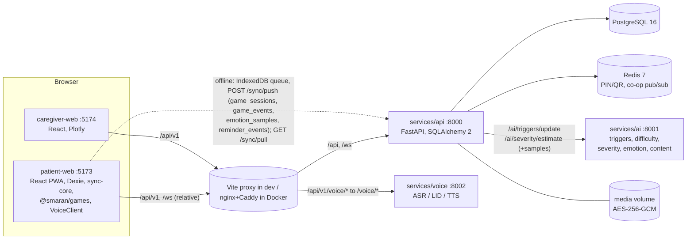

# SMARAN: Understanding Memory Through Emotion

An offline-first, multilingual web platform that helps elderly people living with dementia in North-East India exercise their memory, and helps their families and health workers follow progress remotely.

Built for **Smart India Hackathon 2026**, problem statement **SIH26003** (*AI-Based Cognitive Gaming and Memory Assistance Platform for Elderly Dementia Patients in NER*), team name **SMARAN_GH**. This is the working web version of a future mobile app.

**Built end to end with Claude**: planned, orchestrated and integrated by one developer, with ten parallel Claude builder sessions. See [How it was built](#how-it-was-built-with-claude).

> **SMARAN is a support tool. It does not diagnose dementia and is not a medical device.** Severity indicators are signals for caregivers and clinicians, never a diagnosis.

<!-- gotta add screenshots of prototype. -->

## Contents

[The idea](#the-idea-detect-associate-personalize) · [Features](#features) · [Architecture](#architecture) · [How it was built](#how-it-was-built-with-claude) · [Quick start](#quick-start-native) · [Demo](#seed-and-demo) · [Tests](#tests) · [Environment variables](#environment-variables) · [Safeguards](#safeguards-and-where-they-are-enforced) · [Limitations](#known-limitations) · [Author](#author)

## The idea: Detect, Associate, Personalize

Many memory apps only adapt to a score. SMARAN also learns *which cues* (a family photo, a song, a festival) a patient actually remembers best, then uses those cues to personalize games and voice reminders:

1. **Detect** how the patient responds in each session, with and without a cue.
2. **Associate** cues with recall, using a Bayesian confidence score that decays over time and is re-checked every session.
3. **Personalize** games, difficulty and reminders around the cues that work.

## Features

**Patient app (offline-first PWA)**
- Voice-guided cognitive games across five domains: memory, attention, daily-routine recall, pattern and object recognition, executive function. Difficulty levels 1 to 10.
- Photo Jigsaw: the caregiver uploads a photo, it is cut into pieces, and the patient rebuilds it with the target picture in view.
- Medicine, hydration, activity and appointment reminders.
- Works fully offline and syncs when the network returns.
- Large, calm interface for older users, with no timers and no failure messages.

**Caregiver and health-worker dashboard**
- Role-based views; health workers see many patients sorted by alert priority.
- Trend charts for score, engagement and response time, plus a with-cue vs without-cue recall comparison.
- Memory-trigger profile showing which cues work best and how confident the system is.
- GDS-style severity band, always shown with the support-tool disclaimer.
- Alerts (score drop, inactivity, missed reminders) with acknowledgement and notes.
- Photo and voice uploads, reminder and routine management, consent management, CSV report export.
- Co-op rooms so a remote family member can play alongside the patient.

**Security and privacy**
- JWT with refresh-token rotation and revocation, role-based access control, login rate limiting.
- AES-256-GCM encrypted media with signed, expiring URLs.
- Consent required before camera or microphone use; designed with India's DPDP Act 2023 in mind.

## Architecture



One pnpm workspace (`apps/*`, `packages/*`) with three Python services beside it:

```
smaran/
  apps/            patient-web, caregiver-web
  packages/        contracts, sync-core, design-tokens, games, content, voice-i18n
  services/        api, ai, voice
  scripts/         native-up.sh (starts the three backend services)
  infra/           Docker, compose, CI (not fully tested, see limitations)
  e2e/             Playwright end-to-end test
```

## How it was built (with Claude)

SMARAN was built by one developer directing Claude, using a workflow designed to make parallel AI work merge cleanly, on free-plan limits.

1. **Contract first.** Before any code, I wrote one shared specification: the database schema, every API route and response shape, the game SDK, the sync protocol and fixed function signatures between modules. Every Claude session received the same document, so no session needed another's output.
2. **Ten parallel builders.** Each Claude session owned separate folders: five backend parts (core, auth and consent, media and reminders, sync and co-op, insights and infra), the AI engine, the patient app, the games, the caregiver dashboard, and voice, i18n and the reminder engine. They coded against mocks of each other's work.
3. **Three integrators plus a final integrator.** Separate sessions merged the backend, the services and packages, and the apps, then one final session assembled the monorepo, replaced mocks with real code and ran the full stack. Running everything together surfaced eight integration bugs that no single part had shown.
4. **Token discipline.** Strict rules for every session: no re-planning, no whole-file reads, quiet test output, small patches, checkpoint zips after each milestone, and effort levels matched to the task.
5. **Human in the loop.** I ran the app, found what was wrong (stale dashboard graphs, silent audio, plain UI), had the causes diagnosed from the code, and wrote follow-up prompts for each fix.

Result: 3 backend services, 2 web apps, 6 shared packages, about 570 automated tests and a browser end-to-end test of the full flow.

## Quick start (native)

This is the path that was actually run. Prerequisites: Node 20 or newer, pnpm 9, Python 3.11 with `uv`, PostgreSQL 16 and Redis 7 (on Windows, use WSL2 with Ubuntu).

```bash
sudo service postgresql start && sudo service redis-server start
sudo -u postgres psql -c "CREATE USER smaran WITH PASSWORD 'smaran';"
sudo -u postgres psql -c "CREATE DATABASE smaran OWNER smaran;"

pnpm install                                   # one root workspace
for s in api ai voice; do (cd services/$s && uv venv --python 3.11 .venv && uv pip install -p .venv/bin/python -r requirements-dev.txt); done

./scripts/native-up.sh                         # migrates + seeds, starts api :8000, ai :8001, voice :8002 (logs in .run/)
pnpm dev:patient &  pnpm dev:caregiver &       # :5173 / :5174, proxying /api, /ws, /api/v1/voice
```

Open the patient app at http://localhost:5173 and the caregiver dashboard at http://localhost:5174. Stop with `./scripts/native-up.sh stop` and Ctrl+C in the web terminals. Secrets for the native run are generated into `.run/env` (git-ignored). The database credentials above are for local development only.

**Docker (not run in this build):** `make env && make secrets && make config && make up` uses `infra/docker-compose.yml`, with a Caddy override in `docker-compose.prod.yml`.

## Seed and demo

`seed.py` (run by `native-up.sh`) creates a caregiver `caregiver@smaran.demo` and a health worker `healthworker@smaran.demo`, both with the demo password `Smaran-Demo-123`, plus two patients (Bimala Das and Tomba Singh) with reminders, media, sessions and alerts. This is demo data only. Patient PINs are **6 digits and expire after 10 minutes**, so issue one from the dashboard right before logging in.

Demo script (the main flow):

1. Caregiver app: log in, choose *Add patient* (name, age) and note the PIN.
2. Select the patient, *Upload photo* (the cue) and add a *medicine* reminder.
3. Patient app: enter the PIN, open **Family** (the photo is downloaded and cached), then go offline (DevTools, Network, Offline).
4. **Play**: the game runs from local content with the caregiver photo as a cue.
5. Go online: data syncs, the AI updates triggers, and the caregiver dashboard shows the trend, cue comparison, triggers, severity (with disclaimer) and alerts.

## Tests

| Command | What |
|---|---|
| `cd services/api && .venv/bin/pytest -q` | 352 tests (SQLite; set `TEST_DATABASE_URL=postgresql+psycopg://...` for Postgres, which **wipes that database**) |
| `cd services/ai && .venv/bin/pytest -q` | 85 tests |
| `cd services/voice && VOICE_MODELS_MODE=off VOICE_REQUIRE_AUTH=false .venv/bin/pytest -q` | 10 tests |
| `pnpm -r typecheck && pnpm -r test:unit && pnpm --filter @smaran/games test && pnpm --filter @smaran/voice-i18n test` | TypeScript checks and unit tests |
| `pnpm -r build` | both apps and the games package |
| `pnpm smoke` | API golden path against the real AI service (needs services running) |
| `services/api/.venv/bin/python services/api/scripts/smoke_coop_ws.py` | co-op relay |
| `pnpm test:golden` | Playwright in real Chromium: caregiver, patient offline play, sync, AI, dashboard (needs services running; `PW_CHROMIUM=/path/to/chrome` overrides the browser) |
| `pnpm --filter @smaran/caregiver-web test:e2e` | MSW-backed caregiver specs |
| `services/api/scripts/gen_contracts.sh` | regenerate `packages/contracts/openapi.json` and `schema.d.ts` (run with the API venv on PATH) |

## Environment variables

| Variable | Used by | Purpose |
|---|---|---|
| `DATABASE_URL`, `REDIS_URL` | api | Postgres (psycopg3) and Redis |
| `JWT_SECRET`, `JWT_ALGORITHM` (HS256), `JWT_ISSUER` | api, voice | One shared secret: voice verifies tokens issued by the API |
| `ACCESS_TOKEN_MINUTES` (15), `REFRESH_TOKEN_DAYS` | api | Token lifetimes |
| `MEDIA_KEY_B64` | api | 32-byte AES-256-GCM key (base64). Lose it and all media is lost |
| `MEDIA_DIR`, `MEDIA_URL_TTL_SECONDS` | api | Encrypted media store and signed-URL lifetime |
| `AI_SERVICE_URL`, `VOICE_SERVICE_URL` | api | Upstream services |
| `SYNC_PULL_HOLDBACK_SECONDS` | api | Hides in-flight rows from `/sync/pull` (Postgres cursor gap); 0 for single-writer demos |
| `PATIENT_PIN_TTL_MIN`, `PATIENT_QR_TTL_MIN` | api | PIN and QR lifetime (10) |
| `CORS_ORIGINS` | api | Allowed origins when not same-origin (defaults to both dev ports) |
| `STRICT_MODULES` | api | Fail fast if a router module fails to import |
| `LOGIN_MAX_ATTEMPTS`, `LOGIN_LOCKOUT_MIN`, `BCRYPT_ROUNDS` | api | Auth hardening |
| `GEMINI_API_KEY`, `GEMINI_MODEL` | ai | Optional; templates are used when unset |
| `AI_STATE_DB`, `AI_SERVICE_TOKEN`, `MLFLOW_TRACKING_URI` | ai | State database path, optional bearer token, optional tracking |
| `VOICE_MODELS_MODE` (`off`/`on`), `VOICE_REQUIRE_AUTH` | voice | With models off, the browser's speech is used instead |
| `VITE_API_BASE_URL` (`/api/v1`), `VITE_VOICE_BASE_URL`, `VITE_WS_BASE_URL`, `VITE_USE_MOCKS` | apps | Client configuration (`apps/*/.env.example`) |
| `DEV_PROXY_API`, `DEV_PROXY_VOICE` | apps (dev) | Vite proxy targets |
| `POSTGRES_*`, `REDIS_PASSWORD`, `*_PORT`, `SMARAN_DOMAIN`, `ACME_EMAIL`, `INSIGHTS_SCAN_INTERVAL_MINUTES` | compose | See `infra/.env.example` |

No secret is committed; `.env` files are git-ignored and `.env.example` files are provided.

## Safeguards and where they are enforced

- Camera and microphone are used only after a server-recorded consent (default off): `core/validation/consent.ts`. The voice client only receives a microphone adapter when `mic` consent is granted (`adapters/web/voice.ts`). Emotion capture is off by default.
- Media is AES-256-GCM encrypted at rest (`app/core/crypto.py`; `smoke.py` proves the ciphertext on disk). Every route is protected by role-based access (`assert_can_access_patient`, `require_roles`); a patient cannot read the dashboard or upload.
- The support-tool disclaimer comes from the API (`SUPPORT_DISCLAIMER`) and is rendered next to severity and trends in the caregiver app.
- Elder-friendly interface: 56 px touch targets, 20 px base font, one action per screen, no timers, gentle wording (`games.gentle.*`).
- Only CC0 or placeholder content, and caregiver uploads.

## Known limitations

- **Emotion detection is not live.** The face and speech emotion models are untrained placeholders and emotion capture is not wired into the app. Recall with and without cues is what drives the engine today.
- **Voice uses the browser's built-in speech.** The Indic speech models (AI4Bharat) are integration points, switched off by default.
- **Languages:** English and Assamese strings are included; other languages are machine-drafted and need native-speaker review.
- **Docker, compose and cloud deployment have not been tested.** Use the native path above.
- **No real patient data and no clinical validation.**

More detail: [`KNOWN_GAPS.md`](KNOWN_GAPS.md) (ranked risks), [`CONFLICTS.md`](CONFLICTS.md) (design decisions), [`PORTABILITY.md`](PORTABILITY.md) (reusing the logic in a React Native app), [`INTEGRATION_STATE.md`](INTEGRATION_STATE.md) and `docs/handoffs/` (build history).

## Author

**Muralidhar**: concept, architecture, AI orchestration, integration, testing and local deployment, for Smart India Hackathon 2026 (team name: SMARAN_GH). [LinkedIn: Murali G](https://www.linkedin.com/in/murali-g-729956325/)

Code written by Claude (Anthropic) under my direction. References include LASI-DAD dementia prevalence data and AI4Bharat language tooling.

